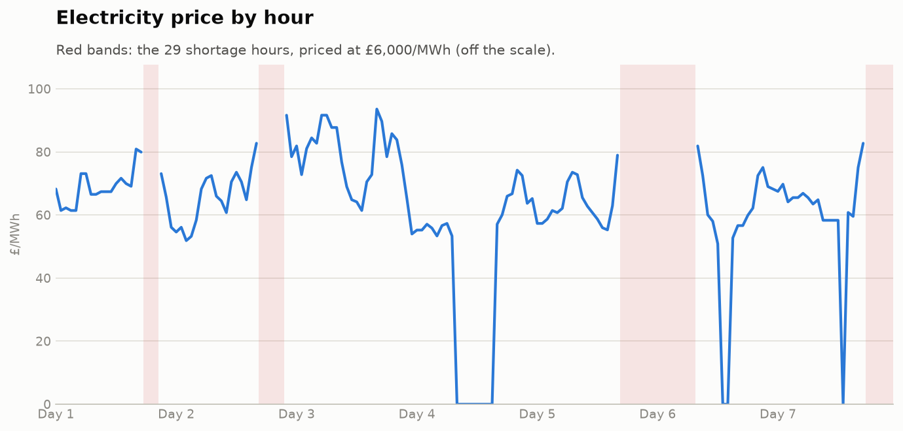
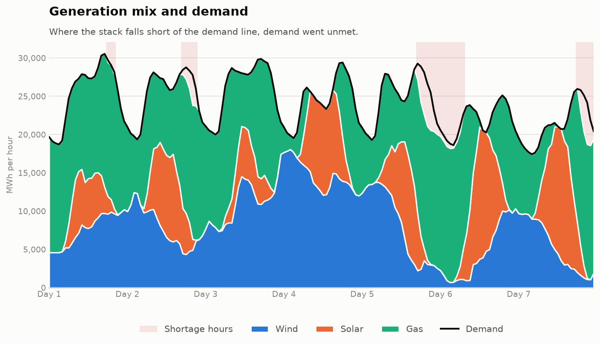
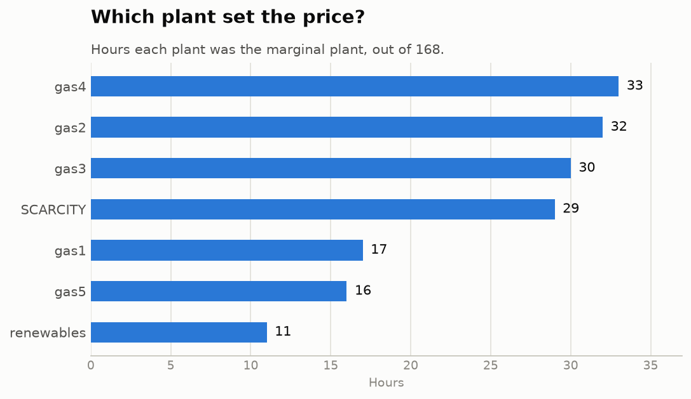
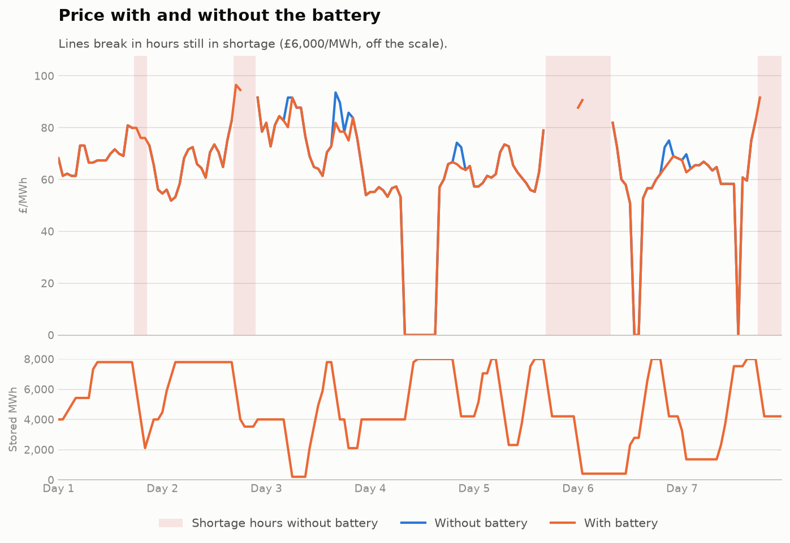

# Electricity auction simulator

This program works out the electricity price and who generates what, hour by hour, for one week of UK-style data. I then added a big battery and checked what it changes.

## How to run

You need Python 3.11 or newer.

```
git clone https://github.com/JunaidA7829/Dispatch-model.git
cd Dispatch-model
python -m venv .venv
source .venv/bin/activate        # Windows: .venv\Scripts\activate
pip install -r requirements.txt
python main.py                   # writes everything to outputs/
pytest -q                        # runs the tests
```

## What's in the repo

```
main.py             runs both scenarios, saves outputs, prints summaries
ASSUMPTIONS.md      every decision the brief left open, with options and reasons
data/data.xlsx      input: plants, load factors, demand, gas prices
src/costs.py        turns the gas price (p/therm) into a bid (£/MWh)
src/data_loader.py  reads and checks the spreadsheet
src/auction.py      the auction itself: clear_hour, build_offers, run_hour, run_all
src/storage.py      the Battery, the daily look-ahead strategy, run_with_battery
src/reporting.py    summary numbers, comparison table, charts, CSV export
tests/              39 pytest tests
outputs/            hourly CSVs and 4 charts, created by main.py
```

## How the auction works

Every hour, each power plant says how much energy it can supply and at what price:
- **Wind and solar** ask for £0. How much they can supply is their capacity × that hour's load factor. One hour at X MW is X MWh.
- **Gas** can supply its full capacity, at a price that just covers its fuel: `bid = (p/therm ÷ 100) × 34.121 ÷ efficiency`, in £/MWh. For example, gas at 70 p/therm in a 35% efficient plant bids £68.24/MWh.

I line the offers up cheapest first and take them until demand is met. The last plant I need is the marginal plant, and its price is what every accepted plant gets paid. That plant can run at part capacity. If several plants ask for exactly the same price, they share what's left in proportion to their size.

## Decisions I had to make

The brief didn't say what happens in some hours, so I made calls. The full list of 13, with the options I weighed, is in [ASSUMPTIONS.md](ASSUMPTIONS.md). The three that matter most:
- **Too much renewable power (11 hours):** the price is £0 and all renewables are turned down by the same percentage. I report the wasted energy as `unused_mwh` (also called curtailment).
- **Not enough power (29 hours):** I charge £6,000/MWh and report the missing energy as `unmet_mwh`. £6,000 is my own assumption, set near the UK's value of lost load. It's a single constant, so it's easy to change.
- **Plants with the same bid:** they share pro-rata. Bids within 1e-6 of each other count as equal.

## Results

Over the 168 hours, with no battery:

| Measure | Result |
|---|---|
| Price £/MWh (average / min / max) | 1,087.09 / 0 / 6,000 |
| Average price excluding shortage hours | £62.09 |
| Energy mix | wind 35.6%, solar 19.7%, gas 44.7% |
| Hours at £0, and unused renewable MWh | 11 hours, 35,969 MWh |
| Shortage hours, and unmet MWh | 29 hours, 60,326 MWh |
| Most common marginal plant | gas4 (33 hours) |

The £1,087 average looks alarming, but 29 shortage hours at £6,000 are doing all the work. £62.09 is a better picture of a normal hour.





What I noticed:
- **Price follows the day.** Outside shortages, the price is around £62 overnight, rises to about £72 in the morning, dips to about £54 at midday (and £37 around 1pm) when solar is strong, then peaks at £74-77 in the evening as solar fades. All 11 of the £0 hours are between 8am and 4pm.
- **The gas price shows up, but wind can hide it.** Gas ran from 70 to 99 p/therm. Day 1 averaged about 78 and day 3 about 92, and the average non-shortage price went from £68 to £78 with it. Day 4 was very windy (61% of energy) and averaged only £40, whatever gas cost.
- **Shortages are low wind plus an evening peak.** There are five runs of them (hours 19-21, 42-46, 114-128, 163-168), mostly in the evening. Wind in those hours averaged 3,176 MWh against 8,460 over the week. Demand was only a little above normal (24,581 vs 24,108 MWh), but gas tops out at 17,500 MW, so it can't fill the gap.
- **That points to a battery.** There's free surplus energy at midday and the highest prices (and shortages) in the evening. Storing one to use in the other is exactly what a battery does.

## The battery

I added one battery with illustrative settings:

| Setting | Value |
|---|---|
| Power | 2,000 MW charging or discharging |
| Size | 8,000 MWh (4 hours at full power) |
| Round trip efficiency | 90%, about 95% each way |
| Start | half full (4,000 MWh) |
| Each hour | charges or discharges, never both |

**How it joins the market.** When it charges, that's extra demand in the auction. When it discharges, it offers energy at break-even: what it paid for the stored energy, divided by 95%. I re-run the auction every hour with the battery included, so its effect on the price is calculated, not assumed. Charging is capped at power that would otherwise be wasted at the same price, so the battery can never push the price up or cause a shortage.

**How it decides when.** It's a daily look-ahead: it knows each day's prices without a battery, then keeps pairing the cheapest hour to charge with the most expensive hour to discharge, 500 MWh at a time. A pair has to earn at least £1/MWh after losses, and the battery must stay between empty and full. The battery's physics (`Battery`) is kept separate from the decision-making (`daily_lookahead`), so trying another strategy means swapping one function.

**What else I could have done.** A simple price rule (charge below £X, discharge above £Y) needs arbitrary thresholds. A full optimisation finds the best schedule but needs perfect foresight and more code. See rows 7-12 of ASSUMPTIONS.md.

| Measure | Without | With battery |
|---|---|---|
| Average price (£/MWh) | 1,087.09 | 805.00 |
| Average price excl. shortage (£/MWh) | 62.09 | 62.85 |
| Median price (£/MWh) | 67.44 | 66.73 |
| Highest price (£/MWh) | 6,000 | 6,000 |
| Shortage hours | 29 | 21 |
| Unmet MWh | 60,326 | 50,002 |
| Unused renewable MWh | 35,969 | 31,252 |
| Gas MWh | 1,783,137 | 1,793,912 |
| Battery profit (£) | - | 35,393,102 |



How I read this:
- **It fixes 8 of the 29 shortage hours** and cuts unmet energy by 10,324 MWh. The other 21 hours need more energy than a 2,000 MW, 8,000 MWh battery can hold.
- **The average price falls only because 8 hours escape the £6,000 price.** In normal hours the price barely changes (£62.09 to £62.85). It even rises slightly, because charging adds demand.
- **The profit is mostly the scarcity price.** £35.1M of the £35.4M comes from selling in shortage hours at £6,000/MWh. Everywhere else it earns about £0.3M. So the profit figure depends on my £6,000 assumption, and I wouldn't read it as ordinary trading.
- **It wastes less renewable energy.** Unused renewables drop by 4,716 MWh as the battery soaks up midday surplus. Gas use goes up slightly (10,775 MWh), because the battery now covers some shortage hours that went unserved before.

## Testing

There are 39 tests. Run them with `pytest -q`.
- **Auction** (`test_auction.py`, `test_clear_hour.py`): hand-checked hours (hour 1 is £68.24 from gas1), tiny made-up markets, ties, surplus and shortage hours, zero volume and empty input. Also checks that output plus unmet energy equals demand, and that no plant goes over capacity.
- **Data** (`test_data_loader.py`): broken copies of the spreadsheet must raise a `ValueError`.
- **Battery** (`test_storage.py`): losses, refusals at the limits, never above full or below empty, never charging and discharging in the same hour, energy and profit adding up, and no extra shortage.

## Limitations and what I'd do next

- The battery knows each day's prices in advance, using the no-battery prices. Real operators have forecast errors.
- It's one battery, with no wear and no grid limits. The settings are illustrative, not a real asset.
- The strategy is a sensible heuristic, not the best possible. A linear programme would show how close it gets.
- The £6,000 scarcity price drives the profit, so the profit is very sensitive to it.
- With more time I'd try several batteries, uncertain forecasts, and a sensitivity check on battery size and the scarcity price.